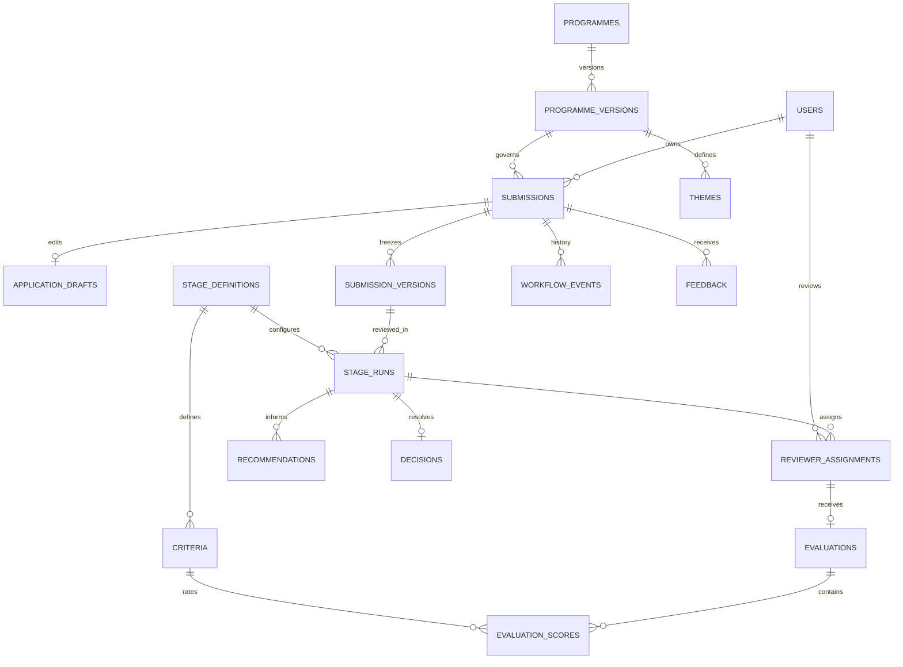

# Relational model proposal

Not a production migration. Application (API/Prisma) maps explicitly to submissions (SQL). Draft -> application_drafts. SubmittedApplicationVersion -> submission_versions. EvaluationAssignment -> reviewer_assignments. No alternate authoritative ideas table.

Application owns identity/owner/pinned programme version/revision and current pointers. Draft owns mutable incomplete answers. Submitted version owns immutable complete answers. StageRun pins an exact version and actual stage visit. Assignment points to that run; Evaluation points to one assignment. History records transitions, not rewritten snapshots. Repeat reviews create new runs and assignments. Team is text only.

## Data dictionary

U = uuid; T = timestamptz(3); J = jsonb; ? = nullable; otherwise NOT NULL. Each id U is a generated primary key. created_at defaults database time. All references below are FKs with restrictive deletion unless specified; PK/unique keys create indexes. revision is nonnegative integer. Additional scope columns in composite FKs are integrity anchors, not independently editable truth.

| Table | Columns | Keys/constraints/relationships |
|---|---|---|
| users | id U, name varchar(100), email varchar(254), status text, authz_revision int, email_verified_at T?, created_at T, updated_at T | Unique normalized email; nonblank name; ACTIVE/SUSPENDED; no role column |
| identities | id U, user_id U, issuer text, subject text, created_at T | user FK; unique issuer/subject; provider-independent mapping |
| sessions | id U, user_id U, token_hash bytea, csrf_token_hash bytea, authn_level text, created_at T, last_seen_at T, idle_expires_at T, absolute_expires_at T, revoked_at T? | user FK; unique hash; expiry ordering; user_id/expiry indexes |
| user_credentials (conditional) | user_id U, password_hash text, changed_at T | PK/FK user; only if local credentials separately approved |
| auth_tokens (conditional) | id U, user_id U, purpose text, token_hash bytea, expires_at T, consumed_at T?, created_at T | user FK; unique hash; single use transaction; provider-dependent |
| roles | code varchar(64), label text, description text | PK code; six initial integration codes |
| permissions | code varchar(100), description text | PK code |
| role_permissions | role_code varchar(64), permission_code varchar(100) | Composite PK, FKs role/permission |
| global_role_grants | id U, user_id U, role_code varchar(64), granted_by U, created_at T, expires_at T?, revoked_at T? | user/role/grantor FKs; partial unique active user/role; expired row explicitly revoked before replacement |
| programme_role_grants | global grant columns plus programme_id U | programme FK; partial unique active user/programme/role |
| programmes | id U, code varchar(64), name text, operational_state text, current_version_id U?, created_at T, updated_at T | Unique code; ACTIVE/PAUSED/ARCHIVED; current version belongs to programme |
| programme_versions | id U, programme_id U, version_number int, publication_state text, brief text, guidelines text, time_zone text, opens_at T?, closes_at T?, form_policy J, initial_stage_id U?, revision int, created_by U, created_at T, published_at T? | programme/creator FKs; unique programme/version; close after open; initial stage same version; immutable published config |
| themes | programme_version_id U, code varchar(64), display_number varchar(8), name text, category text, description text, color varchar(32), icon varchar(32) | Composite PK version/code; version FK; allowlisted style tokens |
| stage_definitions | id U, programme_version_id U, code varchar(64), label text, public_label text?, position int, kind text, review_policy J | version FK; unique version/code and version/position; configurable stages |
| criteria | id U, stage_id U, name text, description text, position int, minimum numeric(8,3), maximum numeric(8,3), weight numeric(8,3), reason_required boolean | stage FK; unique stage/position; max>=min, weight>0 |
| transition_definitions | id U, programme_version_id U, from_stage_id U, to_stage_id U, action_code varchar(64), permission_code varchar(100), guard_policy J | Same-version stage FKs; permission FK; unique from-stage/action; no executable code |
| submissions | id U, reference varchar(40), owner_id U, programme_version_id U, lifecycle text, current_version_id U?, current_stage_run_id U?, revision int, created_at T, updated_at T | Unique reference; user/config FKs; DRAFT/ACTIVE/CLOSED; current pointers belong to same application |
| application_drafts | application_id U, programme_version_id U, base_version_id U?, revision_request_id U?, title varchar(120)?, theme_code varchar(64)?, problem text?, solution text?, impact text?, team varchar(150)?, updated_at T | PK application; same-app config/base/request FKs; optional theme FK; problem<=3000,solution<=5000,impact<=3000 characters; incomplete allowed |
| submission_versions | id U, application_id U, programme_version_id U, version_number int, revision_request_id U?, title varchar(120), theme_code varchar(64), problem text, solution text, impact text, team varchar(150), submitted_by U, submitted_at T | Unique application/version and nonnull revision_request; same-app/config/theme FKs; all six nonblank; same bounds; immutable |
| stage_runs | id U, application_id U, submission_version_id U, stage_id U, sequence int, opened_at T, closed_at T?, due_at T? | Unique application/sequence; version belongs to app; stage same config; close>=open |
| reviewer_assignments | id U, stage_run_id U, reviewer_id U, assigned_by U, state text, due_at T?, revision int, created_at T, revoked_at T? | run/user FKs; partial unique active run/reviewer; exact version derives from run |
| conflict_declarations | id U, assignment_id U, declared_by U, reason text?, created_at T, resolved_by U?, resolved_at T?, resolution text? | Assignment/user FKs; consistent resolution fields; preserve history |
| evaluations | id U, assignment_id U, state text, revision int, constructive_feedback text?, created_at T, updated_at T, submitted_at T? | Unique assignment FK; DRAFT/FINAL; final immutable |
| evaluation_scores | evaluation_id U, criterion_id U, stage_id U, value numeric(8,3)?, reason text? | Composite PK evaluation/criterion; matching stage enforced with composite FK anchors on evaluation/criterion; reason<=2000; draft may omit value |
| feedback | id U, application_id U, submission_version_id U, stage_run_id U?, evaluation_id U?, author_id U, audience text, publication_state text, message text, revision int, created_at T, published_at T?, published_by U? | Same-app/version/run relationships; author/publisher FKs; published immutable; private evaluation feedback never auto-publishes |
| feedback_replies | id U, feedback_id U, author_id U, message text, created_at T | feedback/user FKs; audience checked by service; append-only |
| recommendations | id U, stage_run_id U, author_id U, outcome_code varchar(64), rationale text, state text, revision int, created_at T, finalized_at T? | Run/user FKs; finalized immutable; nonbinding recommendation separate from decision |
| decisions | id U, stage_run_id U, recommendation_id U?, outcome_code varchar(64), rationale text, state text, revision int, decided_by U, created_at T, finalized_at T?, published_at T?, published_by U? | Unique run; recommendation same run; authority and publication separate; finalized immutable |
| revision_requests | id U, application_id U, base_version_id U, requested_by U, reason text, allowed_fields J, due_at T, created_at T, cancelled_at T? | Same-app base FK; fulfillment via unique version.revision_request_id; one actionable request enforced under app lock |
| workflow_events | id U, application_id U, from_run_id U?, to_run_id U?, actor_id U?, action_code varchar(64), reason text?, public_message text?, audience text, application_revision int, occurred_at T | Same-app runs; unique application/revision per transition; append-only |
| attachments (deferred) | id U, application_id U, uploaded_by U, bucket text, object_key text, object_version_id text?, original_name varchar(255), declared_media_type text, verified_media_type text?, size_bytes bigint?, checksum text?, state text, created_at T, scanned_at T? | App/user FKs; unique bucket/key; ready requires verified exact version; size>=0 |
| draft_attachments (deferred) | application_id U, attachment_id U | Composite PK; same-app attachment FK |
| version_attachments (deferred) | submission_version_id U, attachment_id U, application_id U | Composite PK version/attachment; same-app FKs; immutable |
| notifications | id U, user_id U, application_id U?, kind text, title text, message text, created_at T, read_at T? | Recipient/app FKs; safe content; target access rechecked |
| audit_events | id U, actor_id U?, programme_id U?, action text, target_type text, target_id text, reason text?, before_state J?, after_state J?, request_id U, occurred_at T | Actor/programme FKs; target intentionally historical polymorphic identifier; redacted allowlist; restricted append privileges |
| outbox_events | id U, event_type text, aggregate_id U, payload J, attempt_count int, available_at T, processed_at T?, created_at T | attempts>=0; minimal payload; domain transaction |
| delivery_attempts | id U, outbox_event_id U, channel text, state text, provider_reference text?, error_code text?, attempted_at T | outbox FK; no confidential provider error payload |
| idempotency_records | actor_id U, operation text, key varchar(128), request_hash bytea, state text, response_status int?, response_body J?, created_at T, expires_at T | Composite PK actor/operation/key; user FK; authorize before replay; never store login secrets |
| export_jobs (later) | id U, requested_by U, programme_id U, filters J, state text, object_key text?, created_at T, expires_at T? | User/programme FKs; reauthorize downloads; approved retention required |

No authoritative parent title/status text duplicates snapshots/history. form_policy stores field definitions, not answers. Current version/run pointers are constrained references. first submittedAt is version 1 timestamp; selected version submittedAt refers to that snapshot. Reports distinguish current population from historical transitions.

## Constraints and Prisma

Prisma models PascalCase, DTO camelCase, SQL snake_case via explicit @map/@@map. UUID -> String @db.Uuid; T -> DateTime @db.Timestamptz(3); numeric -> Decimal; bytes -> Bytes; bigint -> BigInt (serialize safe size as validated number/string, not raw JSON BigInt). Null drafts convert to empty strings only at DTO boundary. Native foreign keys, not relation emulation.

Use reviewed SQL for checks, partial indexes, immutable triggers/privileges, deferred cyclic current pointers and composite scope FKs. evaluation_scores.stage_id requires a constrained evaluation-stage anchor derived from assignment/run, not an untrusted independent stage field. Exact migration implementation must validate this chain. Ordinary CHECK cannot validate another row's scale or evaluation completeness. Services/constraint triggers enforce these in transactions. Publication requires coherent criteria/weights and graph. API validates UTF-16 lengths matching HTML; DB character checks provide structural bounds; final business rules validate ownership/intake/revisions/deadlines.

Index only evidenced patterns: submissions(owner_id,created_at DESC,id DESC); submissions(programme_version_id,created_at DESC,id DESC); assignments(reviewer_id,state,due_at,id); events(application_id,occurred_at,id); feedback(application_id,publication_state,created_at,id); notifications(user_id,created_at DESC,id DESC); audit(programme_id,occurred_at DESC,id DESC); partial outbox(available_at,id) where unprocessed. PK/unique keys cover versions, configuration ordering, score joins and active grants. Add search/JSON/filter indexes only after EXPLAIN evidence. Do not SELECT all answers in lists or return raw entities.
